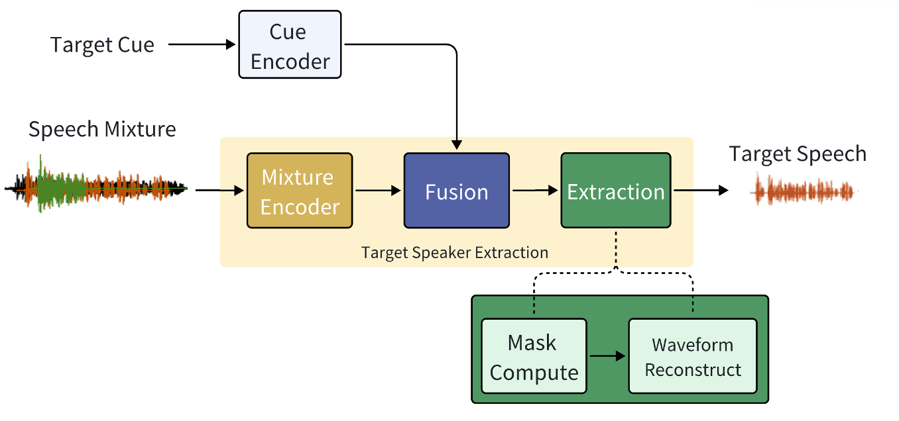

# WeSep 2024

This branch contains the WeSep toolkit accompanying the Interspeech 2024 paper,
with target speaker extraction models, training and inference code, and LibriMix
and VoxCeleb recipes. Model architectures are in [`wesep/models`](wesep/models),
and experiment scripts are in [`examples`](examples).

For the current toolkit, see the
[`master` branch](https://github.com/wenet-e2e/wesep/tree/master).

## The Target Speaker Extraction Task

> Target speaker extraction (TSE) focuses on isolating the speech of a specific target speaker from overlapped multi-talker speech, which is a typical setup in the cocktail party problem.
WeSep is featured with flexible target speaker modeling, scalable data management, effective on-the-fly data simulation, structured recipes and deployment support.



## Features

- [x] On the fly data simulation
  - [x] Dynamic Mixture simulation
  - [x] Dynamic Reverb simulation
  - [x] Dynamic Noise simulation
- [x] Support time- and frequency- domain models
    - Time-domain
        - [x] conv-tasnet based models
            - [x] Spex+
    - Frequency domain
        - [x] pBSRNN
        - [x] pDPCCN
        - [x] tf-gridnet (Extremely slow, need double check)
- [ ] Training Criteria
    - [x] SISNR loss
    - [x] GAN loss  (Need further investigation)
- [ ] Datasets
  - [x] Libri2Mix (Illustration for pre-mixed speech)
  - [x] VoxCeleb (Illustration for online training)
  - [ ] WSJ0-2Mix
- [ ] Speaker Embedding
  - [x] WeSpeaker integration
  - [x] Joint Learned Speaker Embedding
  - [x] Different fusion methods
- [x] Pretrained BSRNN + ECAPA model (English)
- [x] CLI for target speaker extraction
- [x] Runtime

## Download

Clone the 2024 version into its own directory:

```sh
git clone --branch wesep_2024 --single-branch \
  https://github.com/wenet-e2e/wesep.git wesep_2024
cd wesep_2024
```

For an existing clone, fetch the branch and switch to it:

```sh
git fetch origin
git switch wesep_2024
```

To download a ZIP, open the
[`wesep_2024` branch](https://github.com/wenet-e2e/wesep/tree/wesep_2024),
select **Code > Download ZIP**, and extract the archive. Open a terminal in the
extracted directory to follow the installation steps below.

## Installation

Create an environment with Python 3.9, PyTorch 1.12.1, and TorchAudio 0.12.1.
Run these commands from the repository root:

```sh
conda create -n wesep python=3.9 pip
conda activate wesep
conda install pytorch=1.12.1 torchaudio=0.12.1 cudatoolkit=11.3 -c pytorch -c conda-forge
python -m pip install -r requirements.txt \
  "wespeaker @ git+https://github.com/wenet-e2e/wespeaker.git@58071902625ae6b072befda2932a38e9b38d5f26"
python -m pip install --no-deps -e .
```

The installation command includes WeSpeaker at the fixed
[`5807190` snapshot](https://github.com/wenet-e2e/wespeaker/tree/58071902625ae6b072befda2932a38e9b38d5f26)
for this branch's speaker encoders. The editable WeSep installation registers
the `wesep` CLI command.

For development in a Git checkout, enable the formatting hooks:

```sh
pre-commit install
```

## CLI Usage

The `wesep` command extracts a target speaker from a mixture using a separate
recording of that speaker as enrollment audio. Use mono WAV files. The bundled
model runs at 16 kHz, and the CLI resamples the input audio to this rate.

### Use the pretrained model

```sh
wesep \
  --audio_file /path/to/mixture.wav \
  --audio_file2 /path/to/enrollment.wav \
  --output_file extracted_speech.wav
```

The first run downloads the English BSRNN + ECAPA model to `~/.wesep/english/`.
Later runs reuse the cached `config.yaml` and `avg_model.pt`. Inference runs on
CPU by default; add `--device cuda:0` to use a GPU.

`mixture.wav` contains the overlapping speech. `enrollment.wav` contains a
reference recording of the target speaker. The result is saved as a mono WAV
file at the model's sample rate, with peak normalization enabled by default.

### Use a local model

Prepare a model directory containing the configuration and checkpoint:

```text
model_dir/
  config.yaml
  avg_model.pt
```

Use `--pretrain` (or `-p`) to select that directory:

```sh
wesep --pretrain /path/to/model_dir \
  --audio_file /path/to/mixture.wav \
  --audio_file2 /path/to/enrollment.wav \
  --output_file extracted_speech.wav \
  --device cuda:0
```

Use the configuration and model weights from this branch together. Set
`--resample_rate` to the checkpoint's sample rate when using a local model
trained at a rate other than 16 kHz.

### Options

| Option | Description | Default |
| --- | --- | --- |
| `--audio_file` | Mixture audio path | Required input |
| `--audio_file2` | Target-speaker enrollment audio path | Required input |
| `--output_file` | Extracted speech output path | `./extracted_speech.wav` |
| `--pretrain`, `-p` | Local directory with `config.yaml` and `avg_model.pt` | Downloaded model |
| `--language`, `-l` | Bundled pretrained model selection | `english` |
| `--device` | Inference device, such as `cpu` or `cuda:0` | `cpu` |
| `--resample_rate` | Model input and output sample rate | `16000` |
| `--vad` | Apply voice activity detection to the enrollment audio | Off |

View the command-line help with:

```sh
wesep --help
```

## Python API

The Python API uses the same `Extractor` as the CLI. Load the bundled model and
extract speech from a mixture and an enrollment recording:

```python
import soundfile as sf
import wesep

extractor = wesep.load_model("english")
extractor.set_device("cpu")  # Use "cuda:0" for GPU inference.
speech = extractor.extract_speech("mixture.wav", "enrollment.wav")

if speech is not None:
    sf.write(
        "extracted_speech.wav",
        speech[0].numpy(),
        extractor.resample_rate,
    )
```

`load_model("english")` downloads or reuses the same pretrained model as the CLI.
To use a local model directory, replace that call with:

```python
extractor = wesep.load_model_local("/path/to/model_dir")
```

Both functions return an `Extractor`. The extracted speech is a CPU tensor with
shape `[1, samples]`. Configure inference with `set_device(...)`,
`set_vad(True)`, or `set_output_norm(False)` before calling `extract_speech(...)`.

## Recipes

Start with the [LibriMix v2 tutorial](examples/librimix/tse/v2/README.md) for
step-by-step data preparation, training, inference, and scoring. Set the dataset
paths and GPU selection in the recipe before running its stages.

- [LibriMix v2](examples/librimix/tse/v2/README.md)
- [LibriMix v1](examples/librimix/tse/v1/README.md)
- [VoxCeleb online training](examples/voxceleb1/v2/run_online.sh)

Run each recipe from its own directory, as shown in its instructions.

## Data Pipe Design

Following Wenet and Wespeaker, WeSep organizes the data processing modules as a pipeline of a set of different processors. The following figure shows such a pipeline with essential processors.


## Discussion

For Chinese users, you can scan the QR code on the left to join our group directly. If it has expired, please scan the personal Wechat QR code on the right.

|||
| ---- | ---- |


## Citations
If you find WeSep useful, please cite it as

```bibtex
@inproceedings{wang24fa_interspeech,
  title     = {WeSep: A Scalable and Flexible Toolkit Towards Generalizable Target Speaker Extraction},
  author    = {Shuai Wang and Ke Zhang and Shaoxiong Lin and Junjie Li and Xuefei Wang and Meng Ge and Jianwei Yu and Yanmin Qian and Haizhou Li},
  year      = {2024},
  booktitle = {Interspeech 2024},
  pages     = {4273--4277},
  doi       = {10.21437/Interspeech.2024-1840},
}
```
